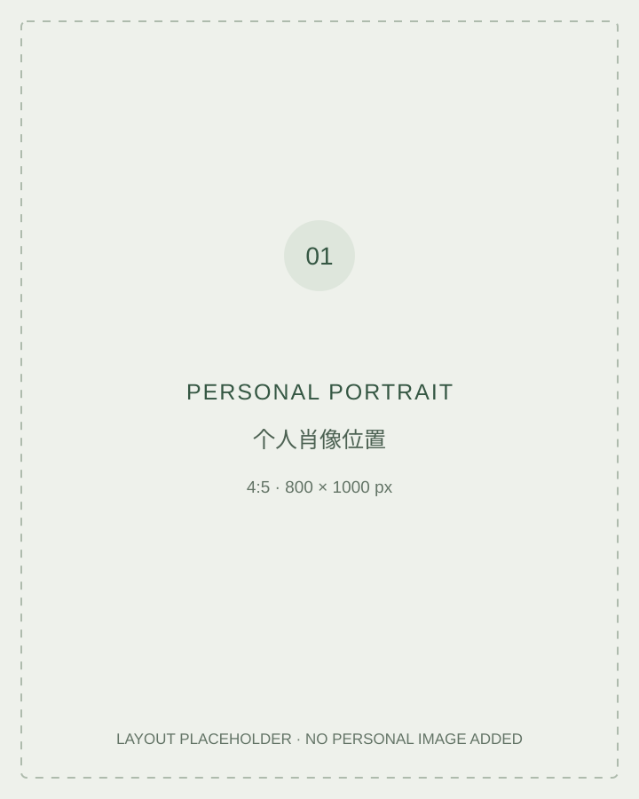

# Liang Xu

**Business, knowledge & social responsibility**

> Portfolio framework · Research writing and supporting records are being prepared.

## About

**TEXT 01 — Background introduction, 80–120 words.**

Introduce the pharmaceutical business background and the university-appointed industry teaching role. The preparation notes suggest a traditional medicine and health-industry context: establish the actual work from primary records before incorporating it. State the organisation, exact title, dates and responsibilities only after checking the underlying records. Explain the questions that led from practice towards anthropology.

### Questions guiding this portfolio

- How do pharmaceutical businesses relate scientific innovation, commercial returns and social responsibility?
- How does industry experience become recognised as expertise in university teaching?
- How can a practitioner examine the assumptions and limits of their own professional knowledge?

 

## Research & writing

| Project | Question and planned material | Status |
|---|---|---|
| [Pharmaceutical value](https://github.com/xuliangweiming/pharmaceutical-value) | Public corporate texts on innovation, patient benefit and commercial value | Research framework |
| [Expertise & teaching](https://github.com/xuliangweiming/expertise-and-teaching) | Industry teaching roles, professional knowledge and institutional recognition | Research framework |

## Professional background

[Appointments, selected awards and educational service](https://github.com/xuliangweiming/professional-background)

**TEXT 02 — Short factual overview, 40–60 words.** Summarise the verified appointment, selected awards and service roles. Supporting records belong in the background repository.

**Image placement:** portrait here; teaching photograph with the teaching project; appointment, award and service images in the background repository.

## Existing website

[Personal website](https://xuliangweiming.github.io/) · [Website source](https://github.com/xuliangweiming/xuliangweiming.github.io)

The website is retained while this additional portfolio structure is developed.
